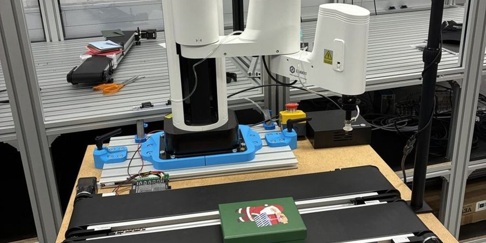
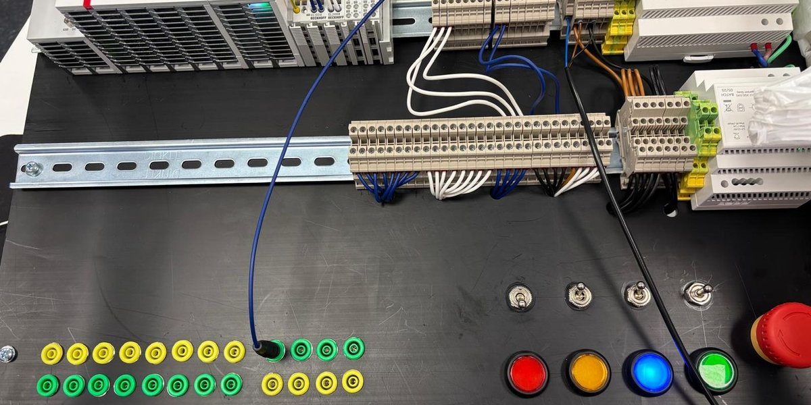

<div align="center">


<br/>

[](https://www.linkedin.com/in/sazzad-mahfuz)
[](https://sazzadmahfuz.github.io)
[](mailto:sazzadibnamahfuz@gmail.com)
[](https://www.hamk.fi)

</div>

---

## About

```python
class SazzadIbnaMahfuz:
    location   = "Helsinki, Finland"
    university = "HAMK University of Applied Sciences"
    degree     = "BEng ICT, Robotics (EQF 6), 2024 - 2028"
    work       = "Robotic welder, K. Hartwall Oy (Yaskawa welding cells)"

    focus = [
        "robot cell integration: Dobot M1 Pro, MG400, Universal Robots",
        "machine vision: YOLO, OpenCV, camera-to-robot calibration",
        "PLC control: Beckhoff TwinCAT 3, Structured Text, EtherCAT",
        "Python control software with safety interlocks and run logging",
    ]

    languages = {"Bengali": "native", "English": "C1", "Finnish": "learning"}
```

---

## Projects

<table>
<tr>
<td width="50%" valign="top">

<a href="https://github.com/sazzadmahfuz/gift-box-packing-cell"></a>

### [Gift Box Packing Cell](https://github.com/sazzadmahfuz/gift-box-packing-cell)

Dobot M1 Pro SCARA, two conveyors and a USB camera that pack gift boxes: one card, two candies, then the lid. YOLO11n detection, homography calibration, RoboDK simulation and a Python cell controller with a safety gate and operator console. Team of three, ongoing.

| Fastest box | Calibration | YOLO P / R | Tests |
|:-:|:-:|:-:|:-:|
| 64.4 s | 0.92 mm | 0.99 / 1.00 | 549 |


</td>
<td width="50%" valign="top">

<a href="https://github.com/sazzadmahfuz/control-systems-plc"></a>

### [Refrigerator Control on a Beckhoff PLC](https://github.com/sazzadmahfuz/control-systems-plc)

Structured Text on a Beckhoff IPC with EtherCAT I/O: door light, TON door alarm with latch and reset, compressor control with hysteresis. LM35 sensor on an EL3074 analog input, TwinCAT VISU HMI and Scope logging. Follow-up lab: PLC handshake with a Dobot MG400.

| Terminals | Alarm | Hysteresis | Sensor |
|:-:|:-:|:-:|:-:|
| 3 | 10 s | ±1.0 °C | LM35 |


</td>
</tr>
</table>

---

## Certifications

| Certification | Issuer | Year |
|---|---|---|
| e-Series Pro Track | Universal Robots Academy | 2025 |
| e-Series Application Track | Universal Robots Academy | 2025 |
| e-Series Core Track | Universal Robots Academy | 2025 |
| CCNA: Introduction to Networks | Cisco / HAMK | 2025 |
| Python Automation | Robocorp | 2024 |
| Occupational Safety Card | Finland | Valid to 2030 |
| Data Science with Python | Simplilearn SkillUp | 2023 |
| Software Architecture | Udemy | 2023 |

---

<div align="center">
<sub>Helsinki, Finland · Open to robotics and automation roles in the Nordic region</sub>
</div>
